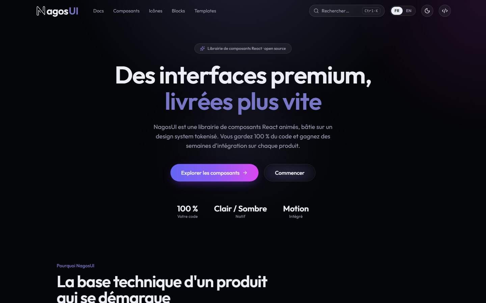
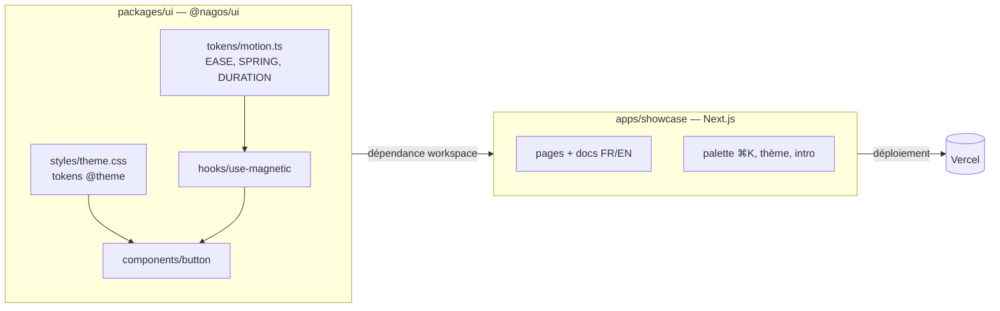

<div align="center">

# NagosUI

**Design system React animé : tokens, composants premium et site de documentation.**

[Démo](https://nagosui.vercel.app) · [Documentation](https://nagosui.vercel.app/docs) · [Contribuer](CONTRIBUTING.md) · [Sécurité](SECURITY.md)

-orange)


</div>

> **Statut : en cours de développement (early-stage).** Seul le composant `Button` (et sa variante `MagneticButton`) est livré.
> Rien n'est publié sur npm : les paquets sont `private` en version `0.0.0`.



## Situation, problème, solution

**Situation.** Chaque nouveau site front recopie couleurs, ombres, rayons et courbes d'animation.

**Problème.** Les valeurs visuelles dérivent d'un projet à l'autre, et les animations « premium » sont réimplémentées à chaque fois.

**Solution.** Une *Foundation Layer* : une source unique de tokens (visuels en CSS, motion en TypeScript) sur laquelle les composants se construisent sans aucune valeur codée en dur. Changer un token change toute la direction artistique.

## Composants

| État | Élément |
| --- | --- |
| Livré | `Button` (variantes `primary`, `glass`, `gradient`, `outline`, `ghost` ; tailles `sm` à `xl`, `icon`) |
| Livré | `MagneticButton` (effet magnétique via le hook `useMagnetic`) |
| Livré | Tokens CSS (`theme.css`) et tokens de motion (`EASE`, `SPRING`, `DURATION`) |
| Bientôt | Blocs, icônes, templates (pages « bientôt » dans le showcase) |

## Stack (versions résolues dans `pnpm-lock.yaml`)

| Techno | Version |
| --- | --- |
| Next.js (App Router) | 16.2.6 |
| React / React DOM | 19.2.6 |
| TypeScript | 5.9.3 |
| Tailwind CSS (CSS-first) | 4.3.0 |
| Motion | 12.38.0 |
| GSAP | 3.15.0 |
| Lenis | 1.3.23 |
| cmdk | 1.1.1 |
| next-themes | 0.4.6 |
| lucide-react | 1.16.0 |
| Turborepo | 2.9.14 |
| pnpm | 10.33.0 |

## Architecture



```
apps/showcase/        site vitrine et documentation (FR/EN)
packages/ui/          @nagos/ui : tokens, hooks, composants
```

## Modèle de tokens

- **Visuels** : `packages/ui/src/styles/theme.css`, via `@theme` de Tailwind v4 (`--color-*`, `--radius-*`, `--shadow-*`, `--blur-*`, `--ease-*`). Génère les utilitaires (`bg-surface`, `rounded-pill`, `shadow-glow`, `ease-out-expo`...).
- **Motion** : `packages/ui/src/tokens/motion.ts` (`EASE`, `SPRING`, `DURATION`) pour Motion et GSAP.
- **Règle** : les composants n'utilisent que ces tokens. Les variantes sont décrites avec CVA (`class-variance-authority`).

Une app branche le système en important `theme.css` dans son `globals.css`.

## Distribution « façon shadcn » via workspace

`@nagos/ui` est consommé comme dépendance `workspace:*` : l'app transpile directement le code source du paquet (`transpilePackages` dans `next.config.ts`, exports pointant vers `src/`). Il n'y a pas de build ni de publication npm à ce stade. Le code reste copiable et personnalisable dans chaque site.

## Défis UI traités

- **Page blanche au retour navigateur** : conflit bfcache + Lenis (commits `d6a544c`, `be7ae14`).
- **Logo sensible au thème**, sans JS ni flash (composant `Logo`, deux images).
- **Indicateur d'actif coulissant** dans la sidebar et le sommaire de la documentation.
- **Transition de thème** fluide.
- **Tokens-only** : aucune valeur visuelle brute dans les composants.

## Commandes

```bash
pnpm install --frozen-lockfile   # dépendances
pnpm dev                         # développement
pnpm build                       # build de production
pnpm typecheck                   # vérification des types
```

Prérequis : Node >= 20, pnpm 10. `pnpm lint` est déclaré mais aucun paquet ne définit encore de script `lint`.
Il n'y a pas de tests automatisés pour l'instant.

## Déploiement

Démo : <https://nagosui.vercel.app>. Chaque app de `apps/*` est un projet Vercel distinct. Pour `apps/showcase` : Root Directory = `apps/showcase`, Build Command = `cd ../.. && pnpm turbo run build --filter=showcase`, Install Command = `pnpm install`.

## Contributions et historique

Projet en développement actif, un seul contributeur : 19 commits entre le 2026-05-16 et le 2026-05-18. 16 de ces commits portent un trailer `Co-Authored-By: Claude Opus 4.7` : le code a été écrit avec l'assistance d'une IA. Voir [CONTRIBUTING.md](CONTRIBUTING.md).

## Droits

Aucune licence n'est accordée pour le moment : **tous droits réservés** par défaut. Le code est visible mais ne peut pas être réutilisé sans autorisation de l'auteur.
