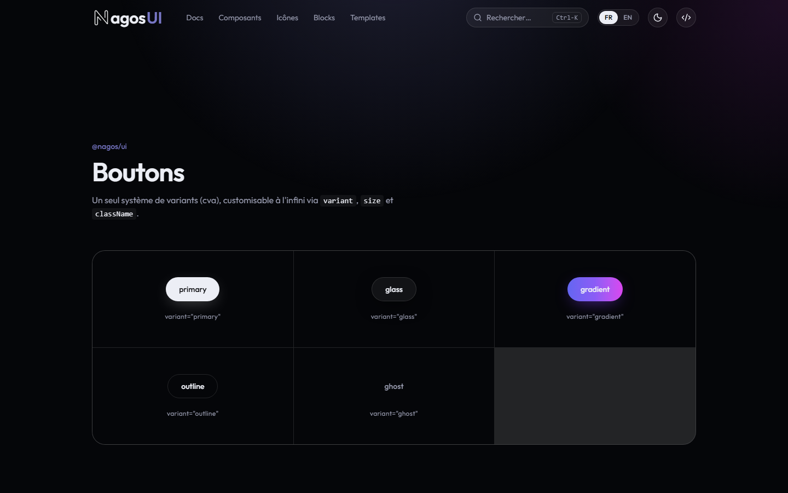

# NagosUI


**Une librairie de composants React premium et animés, dont vous gardez 100 % du code.**

## Description

NagosUI est un monorepo pnpm/Turborepo composé d'une librairie de composants React (`@nagos/ui`) et d'un site vitrine (`apps/showcase`) qui la présente. Le design system repose sur des design tokens Tailwind CSS v4 (couleurs, rayons, ombres, easings) centralisés dans un fichier `theme.css`, et les composants sont animés avec **Motion**. Comme pour shadcn/ui, l'esprit de distribution est de ne pas imposer une dépendance boîte noire : `@nagos/ui` est consommé comme un package du workspace dont le code source est directement visible et modifiable, plutôt qu'un paquet compilé et figé.

## Fonctionnalités clés

- **Design tokens centralisés** — `packages/ui/src/styles/theme.css` (tokens visuels Tailwind v4 : couleurs, rayons, ombres, flous, easings) et `packages/ui/src/tokens/motion.ts` (tokens d'animation JS : `EASE`, `SPRING`, `DURATION`). Aucun composant n'hardcode de valeur brute.
- **Composants animés** — composants construits avec [Motion](https://motion.dev) et [class-variance-authority](https://cva.style/) (ex. `Button` à 5 variants et `MagneticButton`).
- **Site vitrine Next.js** — pages *Composants*, *Icônes*, *Blocks*, *Templates* et *Docs* (ces quatre dernières sont des sections "à venir" dans l'état actuel du dépôt).
- **Expérience soignée** — scroll fluide via [Lenis](https://lenis.darkroom.engineering/), thème clair/sombre (`next-themes`), palette de commandes (`cmdk`), et interface bilingue FR/EN.

## Stack technique

- Next.js 16 (App Router) + React 19 + TypeScript 5
- Tailwind CSS v4 (configuration CSS-first via `@theme`)
- Motion pour les animations UI
- Lenis pour le smooth scroll
- Turborepo + pnpm workspaces pour le monorepo

> Note : `gsap` figure dans les dépendances de `apps/showcase` mais n'est pas encore utilisé dans le code au moment de cette revue — à vérifier/retirer si inutile.

## Démo

Site vitrine en ligne : **[nagosui.vercel.app](https://nagosui.vercel.app)**

## Captures d'écran

| Accueil | Page Composants |
|---|---|
|  |  |

## Installation / lancement local

Prérequis : Node.js ≥ 20 et pnpm (`packageManager: pnpm@10.33.0`).

```bash
pnpm install        # installe les dépendances du monorepo
pnpm dev            # lance le mode dev (toutes les apps via Turborepo)
pnpm build          # build de production
pnpm typecheck      # vérification des types
pnpm lint           # lint
```

Le site vitrine démarre ensuite sur `http://localhost:3000`.

## Utiliser un composant dans un autre projet

Dans l'état actuel du dépôt, il n'existe pas de CLI ni de registre façon `npx shadcn add` : `@nagos/ui` est consommé comme **dépendance de workspace** (`"@nagos/ui": "workspace:*"` dans `apps/showcase/package.json`), ce qui veut dire que le code source du package est directement transpilé et utilisable par les apps du même monorepo, sans build intermédiaire ni paquet publié sur npm.

```ts
import { Button } from "@nagos/ui";
import "@nagos/ui/theme.css"; // à importer une fois dans globals.css de l'app
```

Pour réutiliser un composant **hors du monorepo**, la seule méthode disponible aujourd'hui est de copier manuellement le dossier du composant concerné (ex. `packages/ui/src/components/button/`) ainsi que les tokens (`theme.css`, `motion.ts`) dans le projet cible — dans l'esprit "vous possédez le code" de shadcn/ui, mais sans outillage CLI dédié pour l'instant.

## Structure du monorepo

```text
NagosUI/
├── apps/
│   └── showcase/              # Site vitrine Next.js (déployé sur Vercel)
│       ├── app/                # Routes : /, /composants, /icons, /blocks, /templates, /docs
│       ├── components/         # Sections et composants propres au site vitrine
│       └── lib/                 # i18n, utilitaires
└── packages/
    └── ui/                     # @nagos/ui — design system + composants
        └── src/
            ├── styles/theme.css   # Tokens visuels (@theme Tailwind v4)
            ├── tokens/motion.ts   # Tokens motion (EASE, SPRING, DURATION)
            ├── lib/                # cn()
            ├── hooks/              # useMagnetic…
            └── components/         # 1 dossier par composant (button/, …)
```

---

[GitHub @nagoloumdaniel](https://github.com/nagoloumdaniel) · [Portfolio](https://nagoloum.vercel.app)
